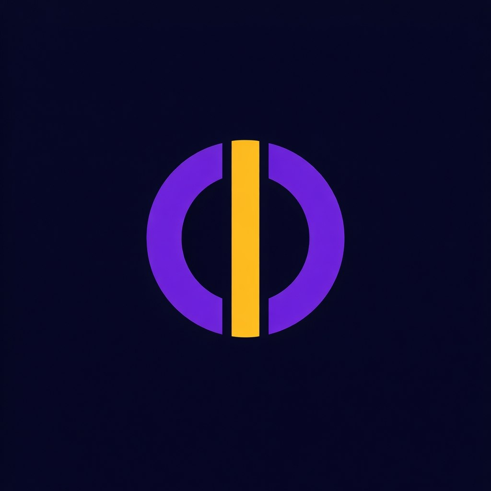

<div align="center">



# Mohshid Karsara · موهشید کارسرا

**Read, edit, and listen to PDF text—offline, in Persian.**

An accessibility-focused desktop application from the **Mohshid Open Accessibility Platform**, built for blind and low-vision users.

[English](README.md) · [فارسی](README.fa.md)

[](https://github.com/alihd-tech/karsara/actions/workflows/checks.yml)
[](LICENSE)
[](#installation-and-development)
[](#privacy-and-local-storage)
[](#project-status)

[Get started](#installation-and-development) · [Features](#what-you-can-do) · [Keyboard shortcuts](#keyboard-shortcuts) · [Contribute](#contributing)

</div>

## What is Karsara?

Karsara turns text-based PDFs into editable text that you can listen to in Persian and export as TXT or Word documents. Its interface uses Persian labels, right-to-left layouts, keyboard controls, and local draft recovery.

Document processing and speech synthesis run on your device. The Persian voice model is bundled with the project, so everyday use does not require a cloud service or an API key.

## Project status

**Karsara is an MVP under active development.** Windows is the installer target. Automated Windows checks cover regression tests, an Electron workflow smoke test, and installer creation; the badge above shows their current status.

Linux development and packaged workflow tests have also been exercised. This does not imply an officially supported Linux or macOS release. Screen-reader behavior, real audio-device playback, and the installed Windows application still require release testing. Accessibility is a design goal, not a claim of certified conformance.

## What you can do

| Capability | Current implementation |
| --- | --- |
| Open a PDF | Native file selection or drag-and-drop; one document at a time |
| Extract and edit text | Local PDF text extraction, word/character counts, selection, and RTL/LTR editing controls |
| Listen in Persian | Offline Ganji voice; read the selection or the whole text, with a Stop control |
| Correct Persian prefixes | Conservative half-space correction for standalone `می`, `نمی`, and `بی`, preserving quotes, URLs, and decimal points |
| Recover your work | Local autosave and a resume link when you reopen the application |
| Export documents | UTF-8 TXT with BOM, or DOCX with RTL formatting and preserved blank paragraphs |
| Use the keyboard | Shortcuts for opening, playback, stopping, pasting with correction, and exporting |

**Not implemented:** OCR for scanned/image-only PDFs, speech recognition, AI-assisted reading, a plugin system, or a web application. These are future possibilities, not available features.

## Installation and development

### Requirements

- **Node.js 24 LTS** and npm; this is the version used in CI.
- Git, a graphical desktop session, and an audio output device for playback.
- Internet access for the initial dependency installation. Installation downloads Electron and platform-specific native libraries.
- Windows for building and validating the Windows installer.

### Run from source

```bash
git clone https://github.com/alihd-tech/karsara.git
cd karsara
npm ci
npm start
```

Use npm with the committed `package-lock.json` to reproduce the dependency tree used in CI. Keep the bundled model directory intact:

```text
models/vits-piper-fa_IR-ganji-medium/
├── fa_IR-ganji-medium.onnx
├── tokens.txt
├── espeak-ng-data/
└── MODEL_CARD
```

### Build the Windows installer

On Windows, after `npm ci`:

```bash
npm run build
```

The build creates an NSIS installer under `dist/`. It packages the speech model as an external resource and unpacks native speech libraries. The command does **not** publish a release. Build on Windows so the installed native dependencies match the target platform.

## Using Karsara

1. Select or drop a text-based PDF, then choose **افزودن** (Add).
2. Review the extracted text in the editor. Edit it, change text direction, or apply Persian prefix correction as needed.
3. Select a passage to hear just that passage, or leave the selection empty to hear the full text. Use **Stop** to cancel synthesis or playback.
4. Choose **مرحله بعد** (Next), then export TXT or DOCX through the save dialog.
5. After saving, use **نمایش فایل ذخیره شده** to reveal the exported file.

Edits autosave after a short pause. On the next launch, choose **ادامه ویرایش** to resume the stored document. Importing a new PDF asks before replacing the existing draft. If a save has not completed, closing prompts you to stay or discard unsaved edits.

### Keyboard shortcuts

Shortcuts apply while Karsara has focus. Availability depends on the current page.

| Shortcut | Action | Where |
| --- | --- | --- |
| `Ctrl + Shift + O` | Open a PDF | All main pages |
| `Ctrl + Shift + P` | Read selected text, or all text | Editor |
| `Ctrl + Shift + Q` | Stop speech | Editor |
| `Ctrl + Shift + V` | Paste with Persian prefix correction, then read | Editor |
| `Ctrl + Shift + W` | Export DOCX | Editor and export workspace |
| `Ctrl + Shift + L` | Export TXT | Editor and export workspace |

The editor also retains standard text editing and undo commands. These shortcuts are not registered system-wide.

## Privacy and local storage

- PDF parsing, text editing, document export, and speech synthesis run locally. The current workflow does not upload your document to a server.
- IndexedDB in the application profile stores the current PDF and edited text for recovery. That draft remains after you close the application; local storage is not an encrypted document vault.
- Generated speech is held in memory. Older application-generated temporary speech WAVs are cleaned up at startup.
- Exported TXT and DOCX files remain in the location you choose.

## Limits and known gaps

| Item | Current behavior |
| --- | --- |
| PDF size | Up to **25 MiB** per file |
| Extracted/exported text | Up to **2,000,000 JavaScript string units**; most Persian characters use one unit |
| Speech processing | Approximately 1,000-character chunks, with a two-minute timeout per processing request |
| Scanned PDFs | Need OCR, which is not included |
| PDF layout | Extraction does not promise original page layout, table structure, or perfect reading order |
| Word appearance | DOCX requests the `B Nazanin` font; appearance depends on fonts installed on the recipient's system |
| Working documents | One current document/draft; no multi-document library or cloud sync |

If no text is found, Karsara explains the OCR limitation. You can still enter text manually in the editor.

## Tests and CI

```bash
npm test
npm run test:smoke
```

- **Regression tests:** PDF validation, Persian text preservation, WAV encoding, database commit/abort handling, CSP style hashes across line endings, IPC authorization/cancellation, and playback races.
- **Electron smoke test:** native PDF import/extraction, correction, autosave/recovery, speech generation/cancellation, and TXT/DOCX export using an isolated temporary profile.
- **Windows CI:** installs locked dependencies, runs both test suites, and builds the installer. See [Application checks](.github/workflows/checks.yml).

The smoke test requires a graphical session. On Linux with Xvfb installed:

```bash
xvfb-run -a npm run test:smoke
```

Before releasing, test the installed application offline on a clean Windows machine with NVDA, keyboard-only navigation, zoom, high contrast, and an actual audio device. Consult [audit remediation](FIXES.md) for verification history and remaining checks; dependency-advisory counts there are a snapshot, not a live security guarantee.

## Architecture

| File or directory | Responsibility |
| --- | --- |
| `main.js` | Window lifecycle, trusted IPC, file dialogs, exports, and processor lifecycle |
| `preload.js` | Restricted bridge between the isolated renderer and the main process |
| `processor.js` | PDF extraction and speech synthesis in disposable utility processes |
| `shared.js` | Transactional IndexedDB storage, import validation, and Persian prefix correction |
| `uploadFile.html` / `uploadFile.js` | Import and resume screen |
| `editor.html` / `editor.js` | Text editing, autosave, and audio playback |
| `workSpace.html` / `workSpace.js` | TXT/DOCX export workspace |
| `validation.js` / `wav.js` | Main-process input validation and in-memory WAV encoding |
| `accessibility.css` | Shared visible-focus and high-contrast styles |
| `models/` | Persian speech model, tokens, eSpeak data, and model card |
| `tests/` | Regression and Electron integration tests |

The stack is Electron, JavaScript, HTML/CSS, `pdf-parse`, `sherpa-onnx-node`, and `docx`. The current application uses no frontend framework and requires no hosted backend.

## Contributing

Contributions to accessibility, Persian text handling, document fixtures, testing, translation, and documentation are welcome. Read [CONTRIBUTING.md](CONTRIBUTING.md) before starting a major change. Keep the English and [Persian README](README.fa.md) aligned when changing features or setup instructions.

For a bug report, include the operating system, steps to reproduce, expected behavior, and relevant logs. Use a non-sensitive sample document whenever possible.

**Report security vulnerabilities privately** using [SECURITY.md](SECURITY.md), rather than publishing sensitive details in an issue.

## License and credits

Karsara is distributed under the [GNU General Public License v3](LICENSE). Bundled models and third-party components retain their own licenses and notices. The [Ganji model card](models/vits-piper-fa_IR-ganji-medium/MODEL_CARD) describes a Persian, single-speaker, medium-quality voice at 22,050 Hz and lists its dataset as CC0; this is a dataset license statement, not a blanket license for every bundled asset.

Karsara is part of **Mohshid — Open Accessibility Platform**. The upstream project is [Mohshido/karsara](https://github.com/Mohshido/karsara).

*Light Beyond Technology · نور دیگر*
